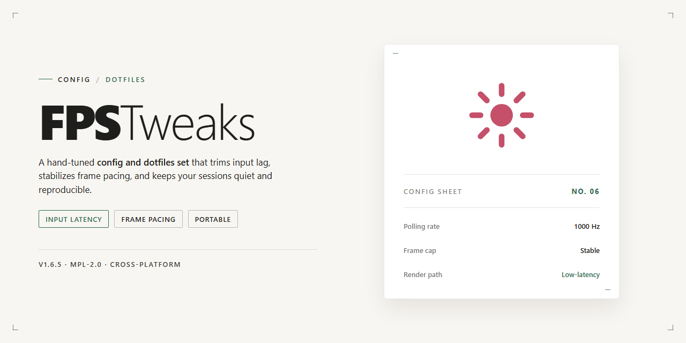

# FPS Tweaks: Performance First, No Compromises — Config

### 🖥️ PowerShell Setup

  

---

FPS Tweaks is a collection of settings and optimizations built for one purpose: making games run better. It increases FPS, cuts stuttering, and tunes system and graphics settings so your hardware stops wasting cycles on background noise. If you want a single, focused config set instead of scattered registry hacks and guesswork, this is it.

## 📋 System Requirements

- Windows 10 or Windows 11
- PowerShell 5.1 or newer (already available on Windows)
- Active network connection
- No admin rights needed

## Features

**One-click profile switching:** Swap between competitive, balanced, and quality presets without touching a config file.
- **Frame time over frame rate:** Targets 1% lows and stutter, not just a bigger number in the corner.
- **Sane defaults, plain text:** Every tweak lives in readable config files — no compiled blobs, no opaque registry dumps.
- **Reversible by design:** Each change is tracked and can be rolled back cleanly. Nothing is permanently baked in.
- **Per-game overrides:** Global defaults are fine; per-title tweaks are better. Layer them without duplicating the whole config.
- **Zero background overhead:** Settings are applied, not babysat. No resident daemon eating the cycles it claims to save.
- **Hardware-aware:** Detects GPU vendor and CPU topology, then skips tweaks that don't apply. No cargo-cult settings.
- **Version-controlled dotfiles:** Everything is a diff away from your last known-good state. Review before you apply.

## Keybinds

**Apply Profile** — `Ctrl+Shift+A`. Loads the active tweak profile. Nothing else is bound here; this is the only key that touches the system.
- **Toggle Tweaks** — `Ctrl+Shift+T`. Enables or disables the current optimization set on the fly. Use it to A/B a profile against stock settings mid-session.
- **Save Profile** — `Ctrl+S`. Writes the current configuration back to disk. No auto-save, no surprises.
- **Reload Config** — `Ctrl+R`. Re-reads the config file after a manual edit. Validate before applying; the loader will reject malformed entries.
- **Panic / Revert** — `Ctrl+Shift+R`. Restores the last known-good snapshot and disables all tweaks. Bind this mentally before anything else.

Everything is rebindable in the config. Defaults assume you have not already bound these in your game launcher — if you have, change ours, not the game's.

## FAQ

**Will this actually raise my FPS?** Yes, if you're CPU or latency bound. No, if you're GPU bound at maximum settings. FPS Tweaks attacks scheduling, timer resolution, and background bloat — not your GPU. Expect the biggest gains in competitive titles at low-to-medium settings.

**Does it modify game files?** No. FPS Tweaks touches system-level and OS-level settings only. Your game installs stay untouched. Nothing gets injected into processes.

**Is this safe to run?** Yes, with the usual caveat: it changes system settings. Create a restore point first. Every change is reversible, and the tweaks are documented so you know exactly what's being altered.

**Windows-only?** Yes. The optimizations rely on Windows internals — process priority handling, timer resolution, power schemes, and service management. There is no Linux or macOS support.

**Will it conflict with my antivirus?** Background service throttling and process priority changes can trip heuristic scanners. Whitelist the tool if you trust it, or run it before launching your game and close it afterward.

**Do I need to reapply tweaks after a reboot?** Timer resolution and some priority settings reset on reboot. Re-run FPS Tweaks before your gaming session, or use the persistent profile option to reapply automatically.

**Can I undo everything?** Yes. The tool ships with a revert function that restores defaults for every setting it changed. If you skipped the restore point, run the revert before doing anything else.

**Will this help on a low-end machine?** More than on a high-end one. The less headroom you have, the more those reclaimed CPU cycles and reduced background noise matter. On a beefy rig you'll see diminishing returns.

**Does it reduce ping or fix packet loss?** Partially. It can reduce latency from your own system — scheduling delays, timer jitter — but it cannot fix your ISP, routing, or server-side issues. Don't expect miracles on a bad connection.

## License

MIT License.

Do whatever you want with these configs — copy, modify, redistribute, ship them in your own setup. No permission needed, no attribution required, no warranty offered.

They are provided as-is. If a tweak tanks your framerate or your system misbehaves, that is on you. Back up your configs before applying anything and test one change at a time.

FPS Tweaks is distributed only through this project. If you got a copy from somewhere else, it is not ours, and we do not support it.